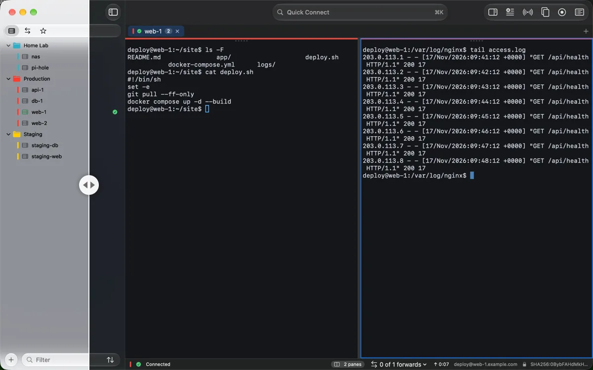
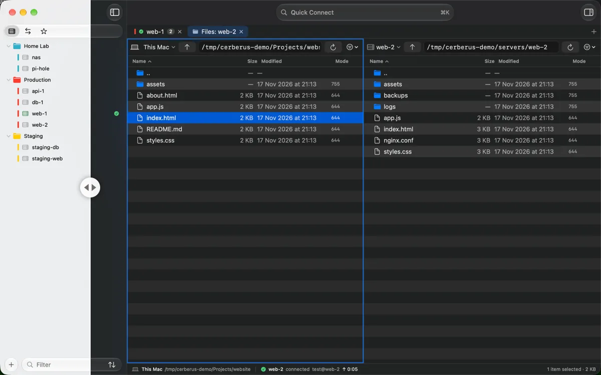
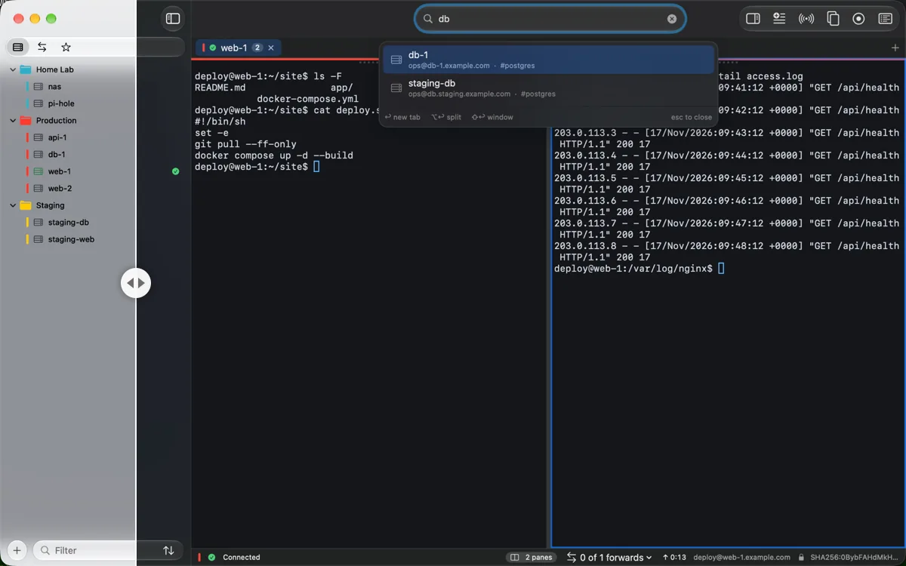
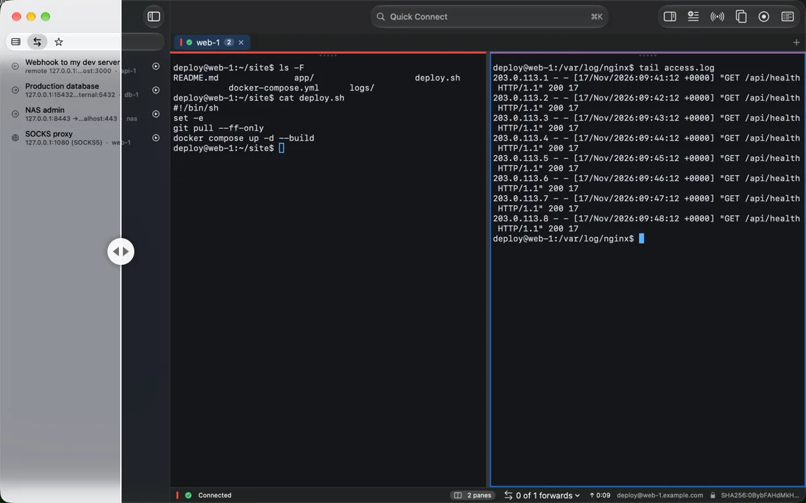
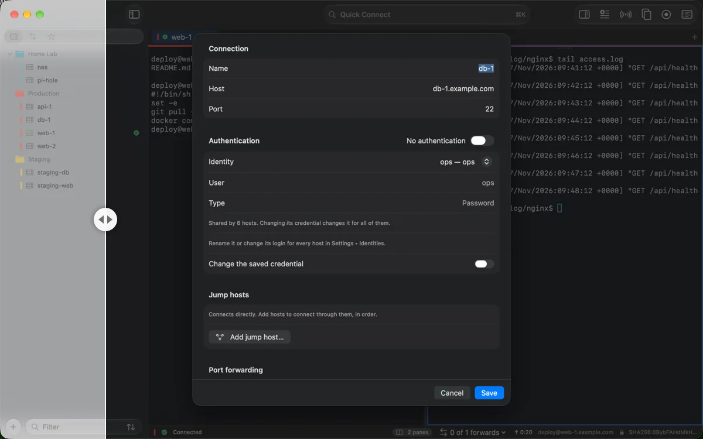
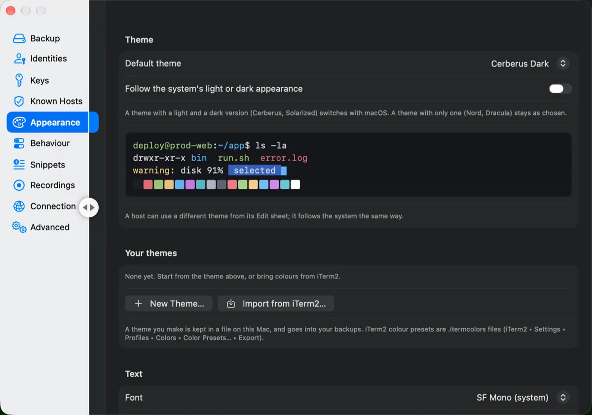

# CerberusSSH

A native macOS SSH client, written in Swift and SwiftUI. It keeps everything on your Mac: your hosts, saved logins and keys are stored locally and sealed with a key held in the Keychain, and there is an encrypted backup you control. There is no account, no cloud service and no telemetry.

**Who it is for:** advanced computer users, people who already know SSH and work quickly. It favours speed and the keyboard over hand-holding.

## What it does

- **SSH.** Public-key (ed25519, ECDSA, RSA), password, one-time code (keyboard-interactive), and signing in with a key held by an `ssh-agent`. Jump hosts. Host keys are trusted on first use, and a changed key blocks the connection. Older servers (RSA, older ciphers and key exchange) are supported.
- **Terminal.** Tabs, split panes, broadcast typing to several panes, snippets, themes, search, paste confirmation, and encrypted per-host session recordings with replay and export.
- **Port forwarding.** Local, remote and dynamic (SOCKS5), with or without a terminal.
- **File tabs (SFTP).** Two panes side by side, each This Mac or a host. Copy by drag and drop between the panes and to and from Finder, drop onto a folder to put things in it (within one place that moves them, as in Finder; hold ⌥ to copy, or ⌘ to move between places), move (⌥⌘V), and edit a server file in place. Folders, links, name clashes, resuming an interrupted copy, and a transfer panel with speed and time left. A copy between two servers streams through your Mac; within one server, the server does the copy.
- **Vault and backups.** Passwords and keys are sealed on this Mac. A passphrase-protected `.cerberusvault` file backs up everything, and automatic backups can go to a folder you choose. Import from `~/.ssh` and `~/.ssh/config`.
- **Organising.** Sidebar tabs for the host/folder tree, port forwards and favourites, each with its own selection. Only Hosts has a bottom bar, with the + menu and filter. The tree sorts by name (A–Z or Z–A), recent or frequent connection, or address, or in a Custom Order you make by dragging folders and hosts into place (dragging works in that order only). Folders with colours (production red, staging amber), tags, a quick-connect field in the middle of the toolbar (⌘K), with a dropdown of matches, and a searchable host picker.
- **Safety copy before a migration.** When an update has to migrate your catalogue, the old file is first copied to `Migration Backups/` with its version in the name. Settings ▸ Advanced lists them, and can re-migrate from one or delete them.
- **Accessibility.** Increase Contrast and Reduce Motion are respected. VoiceOver support is not provided and will not be added.

## Screenshots

Each picture moves between light mode (left of the divider) and dark mode (right of it). The hosts, addresses and files shown are demo data. Click a picture to see it full size.

<table>
  <tr>
    <td align="center" valign="top" width="33%">
      <a href="screenshots/terminal-light.png"></a>
      <br><sub><b>Terminal</b><br>Split panes, host tree with coloured folders</sub>
    </td>
    <td align="center" valign="top" width="33%">
      <a href="screenshots/file-tab-light.png"></a>
      <br><sub><b>File tab (SFTP)</b><br>This Mac beside a server</sub>
    </td>
    <td align="center" valign="top" width="33%">
      <a href="screenshots/quick-connect-light.png"></a>
      <br><sub><b>Quick connect (⌘K)</b><br>By name, address or tag</sub>
    </td>
  </tr>
  <tr>
    <td align="center" valign="top" width="33%">
      <a href="screenshots/port-forwards-light.png"></a>
      <br><sub><b>Port forwards</b><br>Local, remote and SOCKS</sub>
    </td>
    <td align="center" valign="top" width="33%">
      <a href="screenshots/host-editor-light.png"></a>
      <br><sub><b>Host editor</b></sub>
    </td>
    <td align="center" valign="top" width="33%">
      <a href="screenshots/settings-appearance-light.png"></a>
      <br><sub><b>Settings ▸ Appearance</b><br>Themes, your own or from iTerm2</sub>
    </td>
  </tr>
</table>

## Install

**Requires macOS 26 or later** (built and used on 27; 26 compiles but has had less testing). Install it either way, then see [Opening it the first time](#opening-it-the-first-time).

### Disk image

Download `CerberusSSH-<version>.dmg` from the [Releases](../../releases) page, open it and drag CerberusSSH onto Applications.

### Homebrew

CerberusSSH is a cask in the [L4mbd4W0lf/tap](https://github.com/L4mbd4W0lf/homebrew-tap) tap. Trust the tap once, then install:

```
brew trust L4mbd4W0lf/tap
brew install --cask L4mbd4W0lf/tap/cerberusssh
```

Upgrade with `brew upgrade --cask cerberusssh`. If CerberusSSH is already in Applications from the disk image, Homebrew will not overwrite it: add `--force` to the install to replace it with the Homebrew copy (your hosts and settings are kept). `brew info --cask cerberusssh` shows the quarantine step again.

### Opening it the first time

> **Notice:** pre-release builds are not notarised by Apple yet. The app is built from this repository, but macOS has not scanned it, so the first time you open it macOS refuses with a message such as *"CerberusSSH" Not Opened* or *Apple could not verify "CerberusSSH" is free of malware*. This is expected, and you only need to deal with it once per download.

1. **Check the download (optional, recommended).** Each release lists the SHA-256 of its files. Compare it with yours:

   ```
   shasum -a 256 ~/Downloads/CerberusSSH-<version>.dmg
   ```

2. **Let macOS open it,** in either of these ways:

   - **Terminal:** clear the quarantine flag macOS put on the download, then open the app as usual:

     ```
     xattr -dr com.apple.quarantine /Applications/CerberusSSH.app
     ```

   - **System Settings:** open CerberusSSH once and close the message, then go to System Settings ▸ Privacy & Security, scroll to Security, click **Open Anyway** next to the line about CerberusSSH, and confirm with your password or Touch ID.

3. **Updating:** each new version is quarantined again, whether downloaded or upgraded with Homebrew, so repeat step 2 after replacing the app.

Your hosts, keys and settings are not touched by any of this: they live in your user folder and the Keychain, not inside the app.

## Building

The interface in this repository builds against a Swift package (the vault, SSH engine and terminal) that is kept in a separate, private repository, so the app cannot be built from this repository alone. With access to both, clone them side by side in any folder:

```
git clone git@github.com:L4mbd4W0lf/cerberus-ssh.git
git clone git@github.com:L4mbd4W0lf/cerberus-ssh-kit.git
```

then open `cerberus-ssh/CerberusSSH.xcodeproj` (Product ▸ Run), or:

```
xcodebuild -project CerberusSSH.xcodeproj -scheme CerberusSSH -configuration Debug build
```

The project finds the package at `../cerberus-ssh-kit`. Signing is automatic with the team set in the project; change `DEVELOPMENT_TEAM` to yours to build it yourself. The app is not sandboxed, which it needs to reach arbitrary hosts and read the keys you point it at.

The tests, the performance gate and the release scripts are in the kit repository.

## Version numbers

Versions are `major.minor.patch`, with the major number 0 until version 1. **No number other than the first goes past 9**: after 0.1.9 comes 0.2.0, after 0.9.9 comes 1.0.0, and so on; only the major number has no limit. (Until 0.3.0 the limit was 10; 0.2.0 was the first release made under that rule.) The version is the app's `MARKETING_VERSION`.

## How it is put together

```
CerberusSSH/            the app: workspace, sessions, hosts, files, settings, backup, help
CerberusSSHUITests/     UI tests
```

The vault, the SSH engine (with SFTP and an ssh-agent client), the data model and the terminal view live in the separate `CerberusKit` package.

The SSH is [swift-nio-ssh](https://github.com/apple/swift-nio-ssh) (modified, with additions for keyboard-interactive, RSA, older key exchange and agent-signed keys; see [`THIRD_PARTY_NOTICES.md`](THIRD_PARTY_NOTICES.md)); the terminal is [SwiftTerm](https://github.com/migueldeicaza/SwiftTerm). The app never starts a local process: a terminal always runs over an SSH connection (a build step enforces this in the private package).

## What is not built

- iCloud sync (left out of version 1).
- Agent *forwarding*, which will not be built: anyone with root on the server could use your agent while you are connected. Use jump hosts instead.
- Developer ID notarisation (waiting for the certificate).

## Security

Secrets are sealed with AES-GCM under a data key kept in the Keychain (this device only), and zeroed after use. Revealing or replacing a secret can require Touch ID or your password (a setting). Backups are sealed with a passphrase you choose; there is no escrow, so a forgotten passphrase cannot be recovered. If you find a security problem, please report it privately, as [`SECURITY.md`](SECURITY.md) describes.

## Licence

The interface in this repository is under the Apache License 2.0. Copyright 2026 L4mbd4W0lf. See [`LICENSE`](LICENSE) and [`NOTICE`](NOTICE).

CerberusSSH includes the work of others under their own licences (swift-nio-ssh, swift-nio, swift-crypto, SwiftTerm and others), listed with their notices in [`THIRD_PARTY_NOTICES.md`](THIRD_PARTY_NOTICES.md). The modified copy of swift-nio-ssh is Apache-2.0 too; what was changed is in `THIRD_PARTY_NOTICES.md`. Apache-2.0 covers the interface in this repository. The package it builds against is not part of this licence.
